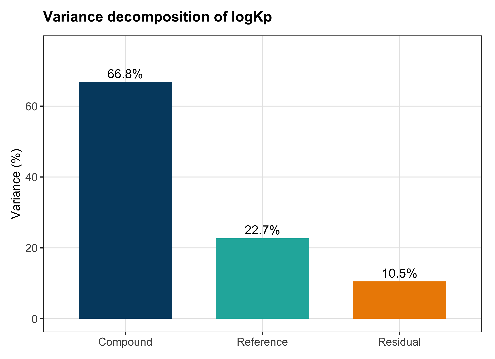
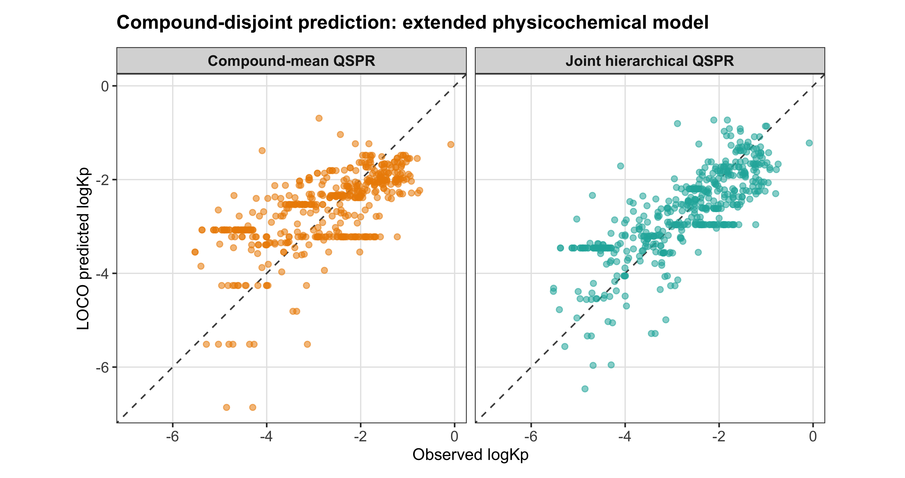
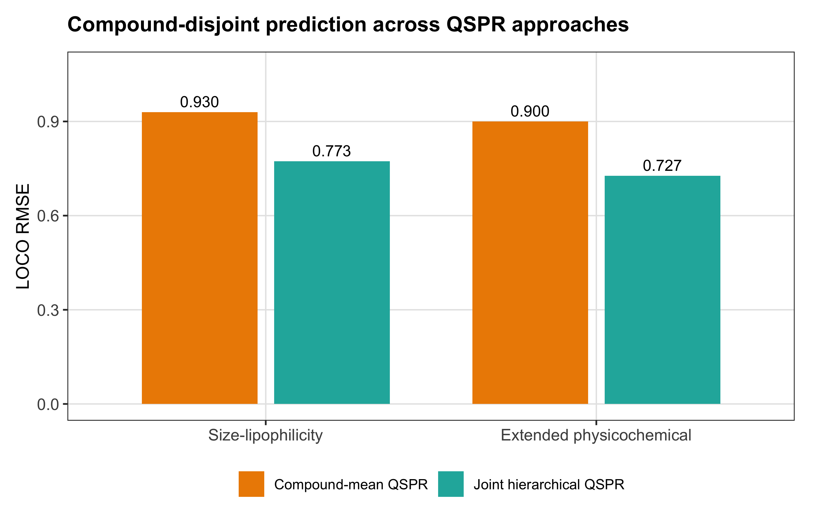

```{r setup, include=FALSE}
knitr::opts_chunk$set(
	echo = FALSE,
	message = FALSE,
	warning = FALSE
)
```

# Introduction

The permeability coefficient of human skin, $K_p$, is widely used to characterize the rate at which a solute crosses the epidermal barrier and is therefore relevant to transdermal drug delivery, topical formulation, toxicological exposure assessment, and chemical screening. Quantitative structure--permeability relationship (QSPR) models have traditionally treated $K_p$ primarily as a function of molecular properties. The classical Potts--Guy model, for example, related permeability to molecular size and octanol--water partitioning and established a simple physicochemical basis for predicting percutaneous transport [@potts1992]. This view has supported several decades of QSPR development, but it also encourages a convenient simplification: that a reported permeability coefficient can be treated as an observed property of the compound itself.

Literature-derived permeability data challenge that simplification. Measurements collected across studies are generated under different experimental conditions and may differ in temperature, membrane preparation, skin thickness, donor and receptor conditions, analytical procedures, and other protocol-specific factors. Consequently, two measurements for the same compound need not represent repeated observations of a single fixed quantity. Variation between reported values may contain both genuine compound-level permeability signal and systematic experimental or study-level variation. This distinction matters when heterogeneous literature measurements are pooled for QSPR development because the response being modeled is then a mixture of molecular and experimental effects rather than a purely compound-intrinsic endpoint.

The problem of interstudy heterogeneity in skin permeability has been recognized for more than two decades. Fujiwara, Yamashita, and Hashida proposed a *latent membrane permeability* framework in which multiple literature datasets were analyzed simultaneously under the assumption that they shared a common underlying structure--permeability relationship despite differences in absolute permeability among datasets [@fujiwara2003]. Their analysis demonstrated that a common molecular relationship could be recovered in the presence of interstudy variability. This work established an important conceptual point: differences among permeability datasets do not necessarily imply different underlying molecular determinants, and study-specific variation can in principle be separated from a shared permeability relationship.

A complementary line of work addressed heterogeneity by standardizing or explicitly modeling experimental conditions. Abraham and Martins adjusted literature human-skin permeability coefficients for ionization and temperature before developing a linear free-energy relationship for permeability at 37 $^\circ$C [@abraham2004]. This approach recognized that literature values measured under different conditions should not necessarily be treated as directly comparable observations. Later, Samaras, Riviere, and Ghafourian incorporated permeant properties, vehicle properties, and experimental factors such as membrane thickness, finite versus infinite dosing, prehydration, and occlusion directly into predictive models of human skin permeation [@samaras2012]. Together, these studies show that both study-to-study heterogeneity and measurable experimental conditions can materially affect apparent skin permeation.

The database of Cheruvu and colleagues provides a useful setting in which to revisit these ideas because the source spreadsheet retains repeated permeability measurements, physicochemical descriptors, experimental variables, and the literature reference associated with each observation [@cheruvu2022]. Rather than collapsing repeated observations immediately to one value per compound, this structure permits the response to be modeled at its natural measurement level.

For compound $i$ measured in reference $j$, we consider the general hierarchical representation

$$
\log K_{p,ij}
=
\theta_i
+
u_j
+\beta_T T_{ij}
+\beta_H H_{ij}
+\epsilon_{ij},
$$

where $\theta_i$ represents the compound-level permeability component, $\nu_j$ is a reference-level effect, $T_{ij}$ and $H_{ij}$ represent experimental temperature and skin thickness, respectively, and $\epsilon_{ij}$ represents remaining measurement-level variation. Under this formulation, molecular structure explains the systematic between-compound component while study and experimental heterogeneity are modeled explicitly rather than absorbed into the response.

The objective of the present study was therefore to determine whether heterogeneous human skin-permeability measurements can be decomposed into interpretable compound, reference, experimental-condition, and residual components, and whether retaining that hierarchy improves QSPR analysis. We first quantified the contributions of compound identity, literature reference, temperature, skin thickness, and residual variation to reported $\log K_p$. We then compared conventional compound-mean QSPR with joint hierarchical QSPR under two fixed molecular specifications: a parsimonious size--lipophilicity model and a broader physicochemical model. Predictive performance was evaluated by leave-one-compound-out cross-validation so that all measurements of the test compound were excluded from model fitting. The aim was not to identify a maximally optimized molecular equation, but to test whether explicit treatment of measurement hierarchy improves inference and prediction when molecular information is held constant.

# Methods

## Data source and preprocessing

The analysis used the human epidermal permeability dataset and accompanying physicochemical and experimental variables compiled by Cheruvu et al. [@cheruvu2022]. The source spreadsheet was imported without averaging repeated permeability measurements. Completely blank spreadsheet rows were removed, numeric fields were audited before coercion, and all exclusions were recorded explicitly.

Compound identity was harmonized before modeling. Normalized compound names were used as the primary identity key, with explicit mapping of clear spelling, capitalization, and synonym variants. CAS numbers were retained as supporting metadata and used to audit identity rather than as the sole compound identifier because the source spreadsheet contained at least one CAS number assigned to chemically distinct named compounds. Ambiguous or chemically distinct names were therefore retained as separate compounds even when CAS metadata overlapped. Repeated observations sharing the same compound, reference, temperature, and skin thickness were retained as individual measurements because substantial within-profile variation remained in the source data.

After preprocessing, the analysis dataset contained 499 permeability measurements from 148 canonical compounds across 69 literature references. All 148 compounds had complete values for the molecular descriptors used in both primary QSPR specifications.

## Descriptive characterization of the dataset

Before model fitting, the dataset was summarized at the compound and reference levels. We quantified the number of repeated observations per compound, the number of references in which each compound appeared, variation in temperature and skin thickness within compounds, and the range of observed $\log K_p$ within repeatedly measured compounds. These summaries were used to assess whether the data contained sufficient replication and cross-reference overlap to support hierarchical modeling.

```{r table1}
table_1 <- readr::read_csv(
	"tables/table_1_dataset_structure.csv",
	show_col_types = FALSE
)
knitr::kable(
	table_1,
	caption = "Dataset structure and repeated-measurement characteristics."
)
```

## Hierarchical decomposition of permeability measurements

Nested linear mixed-effects models were used to separate compound-, reference-, condition-, and observation-level variation. Compound identity and literature reference were represented by random intercepts. Experimental temperature and skin thickness were evaluated as fixed effects after centering at their observed means. Four nested models were considered:

$$
\begin{aligned}
M0:\quad & \log K_p \sim 1 + (1|\mathrm{compound}),\\
M1:\quad & \log K_p \sim 1 + (1|\mathrm{compound}) + (1|\mathrm{reference}),\\
M2:\quad & \log K_p \sim T + (1|\mathrm{compound}) + (1|\mathrm{reference}),\\
M3:\quad & \log K_p \sim T + H + (1|\mathrm{compound}) + (1|\mathrm{reference}).
\end{aligned}
$$

Models were fitted using restricted maximum likelihood (REML) for parameter estimation. Maximum-likelihood versions were fitted for comparison of models differing in fixed effects. Model fit was assessed using AIC, BIC, and sequential likelihood-ratio comparisons. The likelihood-ratio comparison introducing a random-effect variance component was interpreted together with information criteria because a variance component is tested on the boundary of the parameter space.

The primary hierarchical model was selected before QSPR analysis. Variance components were reported as proportions of the total random-plus-residual variance.

```{r table2}
table_2 <- readr::read_csv(
	"tables/table_2_hierarchical_model_comparison.csv",
	show_col_types = FALSE
)
knitr::kable(
	table_2,
	caption = "Comparison of nested hierarchical permeability models."
)
```

## Hierarchical model diagnostics and standardized compound estimates

The selected hierarchical model was evaluated for optimizer convergence, singularity, residual distribution, residual trends with fitted values and temperature, large standardized residuals, and the distributions of compound- and reference-level random effects. Because the residual distribution showed heavier-than-normal tails, robustness to extreme residuals was examined in sensitivity analysis rather than modifying the primary model post hoc.

Reference- and temperature-standardized compound estimates were also obtained as the fixed intercept plus the compound random effect, corresponding to the model centering temperature and a reference random effect of zero. These empirical-Bayes estimates were retained as descriptive outputs. They were not used as the primary QSPR endpoint because their uncertainty and degree of shrinkage vary with the amount of information available for each compound.

## Fixed molecular QSPR specifications

To avoid outcome-driven feature selection, two molecular specifications were defined before QSPR comparison and were retained in full regardless of individual coefficient significance.

The parsimonious size--lipophilicity specification (S1) was

$$
f_{S1}(X_i)=\beta_1 MW_i+\beta_2\log K_{ow,i}.
$$

The extended physicochemical specification (S2) was

$$
f_{S2}(X_i)=
\beta_1 MW_i+
\beta_2\log K_{ow,i}+
\beta_3 MP_i+
\beta_4\log S_{aq,i}+
\beta_5 HBD_i+
\beta_6 HBA_i.
$$

These descriptors represent molecular size, lipophilicity, solid-state constraint, aqueous solubility, and hydrogen-bonding capacity. When multiple source rows contained slightly different values for the same descriptor within a canonical compound, the median value was used in the primary analysis. Descriptor scaling was calculated across compounds rather than observations so that highly replicated compounds did not receive additional weight.

## Conventional and joint hierarchical QSPR

For each molecular specification, a conventional QSPR was fitted to the arithmetic mean $\log K_p$ of each compound:

$$
\overline{\log K_{p,i}}=f(X_i)+\epsilon_i.
$$

The corresponding joint hierarchical QSPR retained all measurement-level observations:

$$
\log K_{p,ij}
=
f(X_i)
+\beta_T T_{ij}
+b_i
+u_j
+\epsilon_{ij},
$$

where $f(X_i)$ is the fixed molecular specification, $b_i$ is the residual compound-level random effect after accounting for molecular descriptors, and $u_j$ is the reference-level random effect. Temperature was retained as the experimental fixed effect because it improved the hierarchical model, whereas skin thickness was not retained in the primary model.

The proportion of between-compound variance explained by molecular descriptors was calculated as

$$
1-\frac{\sigma^2_{\mathrm{compound,joint}}}
{\sigma^2_{\mathrm{compound,baseline}}},
$$

where the baseline model contained temperature and the same compound and reference random effects but no molecular descriptors.

## Compound-disjoint cross-validation

Predictive performance was evaluated using leave-one-compound-out cross-validation (LOCO-CV). In each fold, all measurements belonging to one compound were excluded from training. Descriptor means and standard deviations were recalculated using training compounds only, and the held-out compound was scaled using those training-fold parameters.

The conventional model produced one molecular prediction for the held-out compound, which was compared with each observed measurement of that compound. The joint hierarchical model predicted the same held-out measurements using molecular descriptors and temperature. Reference random effects were included when the held-out observations belonged to references represented in the training data; an unseen reference received a random effect of zero. The held-out compound random effect was necessarily zero because the compound was unseen during model fitting.

Performance was summarized using RMSE, MAE, predictive $R^2$, and Pearson correlation. Because compounds contributed unequal numbers of measurements, a second set of metrics was calculated by first computing error within each held-out compound and then averaging across compounds so that each compound contributed equally.

## Sensitivity analyses

Four prespecified sensitivity analyses were used to test whether the main conclusion depended on particular data or modeling choices. First, the extended physicochemical analysis was repeated using only compounds observed in at least two references, where compound and reference effects are most directly separable. Second, observations with absolute standardized residuals greater than 3 under the primary hierarchical model were excluded. Third, mean rather than median descriptor values were used when source values differed within compounds. Fourth, a more flexible nonlinear molecular specification was evaluated:

$$
MW+\log K_{ow}+MP+\log S_{aq}+(\log S_{aq})^2+HBA+\log K_{ow}\times HBA.
$$

The nonlinear specification was treated only as a robustness analysis and was not used to select the primary molecular model.

## Software and reproducibility

All analyses were performed in R using scripted, numbered workflow files. Data preparation, descriptive summaries, hierarchical modeling, diagnostics, QSPR analyses, sensitivity analyses, and manuscript outputs were separated into independent scripts. Intermediate analysis outputs were written to `R/results/`, while manuscript-ready tables and figures were generated only by the final `99a_make_tables.R` and `99b_make_figures.R` scripts.

# Results

## Dataset structure supports hierarchical modeling

The final analysis contained 499 measurements from 148 compounds and 69 references. Repeated measurements were common, and a substantial subset of compounds appeared across multiple literature references and/or experimental conditions, providing the replication needed to separate compound-level and reference-level variation. Repeated experimental profiles were retained because observations sharing the same recorded compound, reference, temperature, and skin thickness could still differ materially in $\log K_p$.

## Reference and temperature effects account for substantial heterogeneity

Adding a reference-level random effect produced a large improvement over the compound-only model (AIC 1031.1 versus 823.4). Adding temperature further improved fit (AIC 813.0; likelihood-ratio $\chi^2=12.35$, $p<0.001$), whereas adding skin thickness did not improve the temperature-adjusted model (AIC 814.4; likelihood-ratio $\chi^2=0.65$, $p=0.419$). Model M2, containing compound and reference random intercepts together with temperature, was therefore retained as the primary hierarchical model.

Under M2, approximately 66.8% of random-plus-residual variance was attributed to compound identity, 22.7% to literature reference, and 10.5% to residual measurement-level variation (Figure 1). Thus, nearly one quarter of the remaining permeability variation was associated with the literature source after accounting for compound identity and temperature.

```{r figure1, fig.cap="Variance decomposition of the primary hierarchical model. Percentages represent the share of total random-plus-residual variance attributed to compound identity, literature reference, and residual measurement-level variation."}

```

No optimizer convergence warning or singular fit was observed for the primary model. Residuals were approximately symmetric but showed heavier-than-normal tails, motivating the extreme-residual sensitivity analysis rather than post hoc alteration of the primary model.

```{r table3}
table_3 <- readr::read_csv(
	"tables/table_3_primary_hierarchical_model.csv",
	show_col_types = FALSE
)
knitr::kable(
	table_3,
	caption = "Fixed effects and variance decomposition of the primary hierarchical model."
)
```

## Molecular descriptors explain a majority of between-compound variance

Both fixed molecular specifications explained substantial between-compound variation within the hierarchical framework. The size--lipophilicity model S1 reduced compound random-effect variance by 60.4%, while the extended physicochemical model S2 reduced it by 61.7%. Relative to the hierarchical baseline without molecular descriptors, both specifications produced large improvements in maximum-likelihood fit. For S1, $\Delta$AIC was -108.0 and $\Delta$BIC was -99.6; for S2, $\Delta$AIC was -107.9 and $\Delta$BIC was -82.6. Likelihood-ratio tests were highly significant for both specifications ($p<10^{-22}$).

The nearly identical AIC values of the two joint models indicated that the broader S2 descriptor set added only modest in-sample explanatory value beyond molecular size and lipophilicity. S1 was more parsimonious by BIC, whereas S2 was retained as the broader physicochemical specification for predictive comparison rather than being selected as a unique best model.

## Hierarchical QSPR improves compound-disjoint prediction

The hierarchical advantage was observed under both fixed molecular specifications. For S1, LOCO RMSE decreased from 0.930 for conventional compound-mean QSPR to 0.773 for joint hierarchical QSPR, a 16.8% reduction. MAE decreased from 0.743 to 0.599, while predictive $R^2$ increased from 0.359 to 0.557.

For S2, LOCO RMSE decreased from 0.900 to 0.727, a 19.2% reduction, and MAE decreased from 0.719 to 0.567, a 21.2% reduction. Predictive $R^2$ increased from 0.399 to 0.608, and Pearson correlation increased from 0.642 to 0.780. All 148 LOCO folds completed successfully for both specifications.

The observed-versus-predicted distributions illustrate the distinction between the two approaches (Figure 2). Conventional compound-mean QSPR assigns one molecular prediction to all measurements from the held-out compound, producing horizontal bands when that compound has repeated measurements. The joint model additionally accounts for temperature and reference context, allowing predictions to vary across measurements of the same held-out compound.

```{r figure2, fig.cap="Compound-disjoint prediction under the extended physicochemical specification. In each LOCO fold, all measurements of one compound were excluded from training. The conventional model assigns one molecular prediction per held-out compound, whereas the joint hierarchical model additionally represents measurement context through temperature and reference effects."}

```

The improvement was not an artifact of highly replicated compounds. When error was summarized within each held-out compound and then averaged equally across compounds, S1 mean compound RMSE decreased from 0.684 to 0.563 (17.8%), and S2 mean compound RMSE decreased from 0.659 to 0.564 (14.5%). Mean compound MAE decreased by 17.7% for S1 and 14.9% for S2.

```{r figure3, fig.cap="LOCO RMSE for conventional compound-mean and joint hierarchical QSPR under two fixed molecular specifications. The hierarchical approach reduced prediction error under both the parsimonious size--lipophilicity model and the extended physicochemical model."}

```

```{r table4}
table_4 <- readr::read_csv(
	"tables/table_4_qspr_performance.csv",
	show_col_types = FALSE
)
knitr::kable(
	table_4,
	caption = "Compound-disjoint predictive performance of the two fixed molecular specifications."
)
```

## Sensitivity analyses support the primary conclusion

The hierarchical advantage persisted across all sensitivity analyses. Restricting the analysis to compounds appearing in at least two references increased the fraction of compound variance explained by the extended molecular specification to 86.6%, while the joint model retained a 14.1% reduction in row-level LOCO RMSE relative to compound-mean QSPR. Excluding observations with absolute standardized residuals greater than 3 produced 61.9% compound-variance explanation and a 20.3% RMSE reduction. Replacing median descriptor values with means produced nearly unchanged results (61.5% compound-variance explanation; 18.9% RMSE reduction).

The expanded nonlinear molecular specification explained more between-compound variance (72.1%) but produced a smaller hierarchical-versus-conventional predictive advantage (8.8% RMSE reduction). Thus, the central result did not depend on the simpler primary molecular specification, on the descriptor aggregation rule, or on a small number of extreme residuals. Compound-balanced sensitivity metrics showed the same direction of effect in every scenario.

```{r table5}
table_5 <- readr::read_csv(
	"tables/table_5_sensitivity_analyses.csv",
	show_col_types = FALSE
)
knitr::kable(
	table_5,
	caption = "Sensitivity analyses of compound-variance explanation and LOCO prediction."
)
```

# Discussion

<!-- TODO: Discussion. Suggested structure:

1. Principal finding
   - Literature-derived human skin permeability is strongly hierarchical.
   - Reference-level heterogeneity remains substantial after accounting for compound identity and temperature.
   - Modeling this structure improves prediction even when molecular information is held fixed.

2. Relation to prior work
   - Connect explicitly to Fujiwara's latent permeability concept.
   - Contrast hierarchical decomposition with deterministic standardization in Abraham and Martins.
   - Relate explicit experimental-condition modeling to Samaras et al.
   - Emphasize that the contribution is not a new descriptor set or high-complexity algorithm.

3. Interpretation of S1 versus S2
   - Size and lipophilicity capture much of the molecular signal.
   - Broader physicochemical descriptors improve LOCO prediction modestly but not in-sample information criteria enough to justify a "best-model" claim.
   - The hierarchical advantage is more stable than the choice between molecular equations.

4. Meaning of the reference effect
   - Reference effects should not be interpreted as study quality scores.
   - They capture systematic differences among literature sources not explained by the recorded covariates.

5. Limitations
   - Reference identity is a proxy for multiple unmeasured protocol differences.
   - Joint LOCO predictions use known reference effects when the reference is represented in training; this evaluates prediction of an unseen compound in a known literature context rather than a completely unseen future study.
   - Random-intercept assumptions and approximately Gaussian residual model.
   - Descriptor values are literature-derived and may vary between sources.
   - Dataset remains modest in chemical diversity relative to modern large-scale molecular ML datasets.

6. Implications
   - Literature QSPR benchmarks should preserve repeated measurements and study identity where available.
   - Hierarchical modeling may be useful for other heterogeneous physicochemical and toxicological endpoints.
-->

# Conclusions

<!-- TODO: Concise conclusion, approximately one paragraph. -->

# Data and code availability

<!-- TODO: Insert final repository URL, archived release/DOI if available, and identify which processed datasets can be redistributed. -->

# Author contributions

<!-- TODO: Add CRediT-style author contributions. -->

# Funding

<!-- TODO: Add funding statement and grant numbers, or state that no specific funding was received. -->

# Competing interests

<!-- TODO: Add competing-interest declaration. -->

# Acknowledgements

<!-- TODO: Add acknowledgements if applicable. -->

# Supplementary information

Supplementary outputs include the full reference-level random-effect plot, residual diagnostic figures, coefficient tables, large-residual audit, and detailed sensitivity-analysis outputs generated by the reproducible R workflow.

# References
