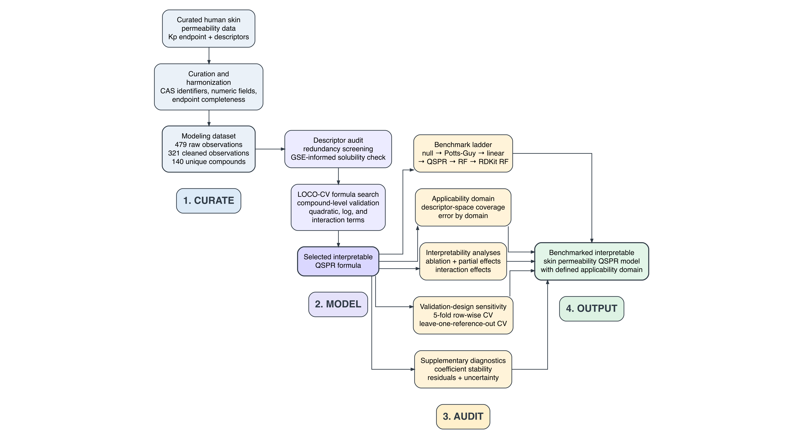
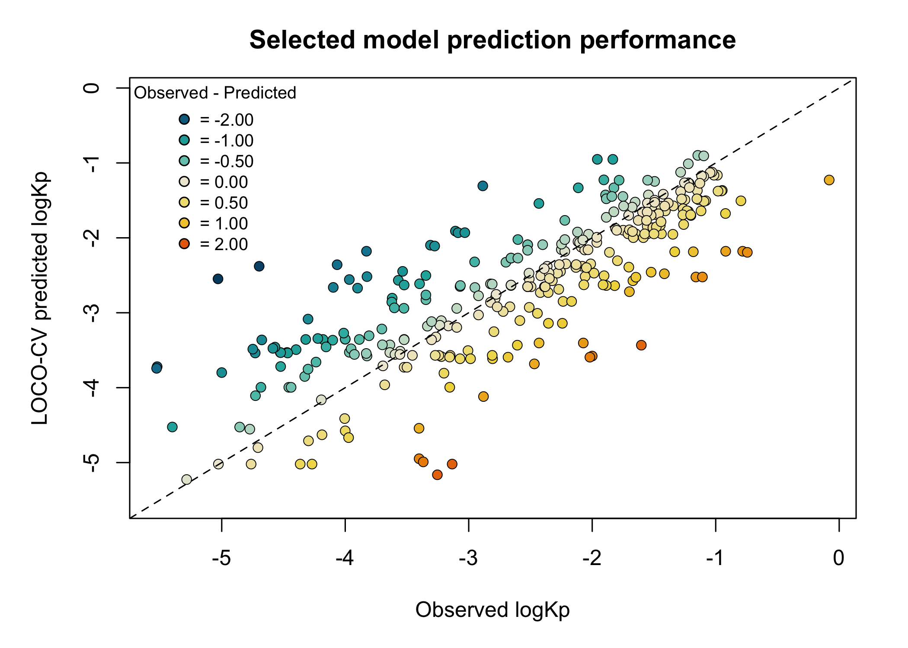
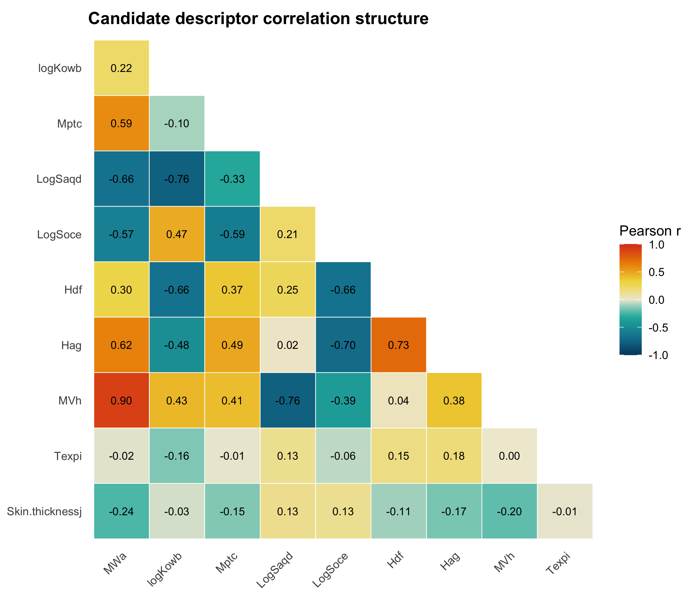
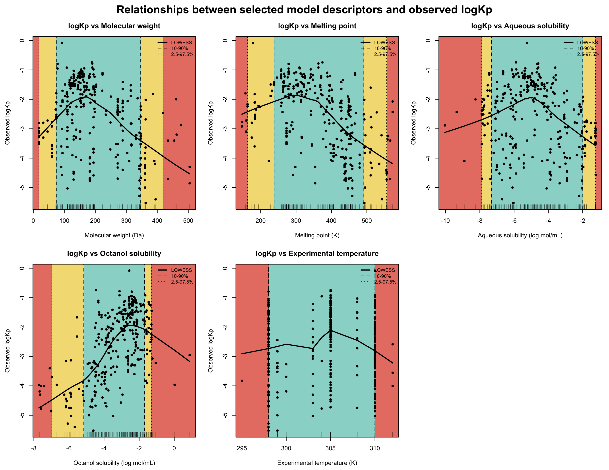
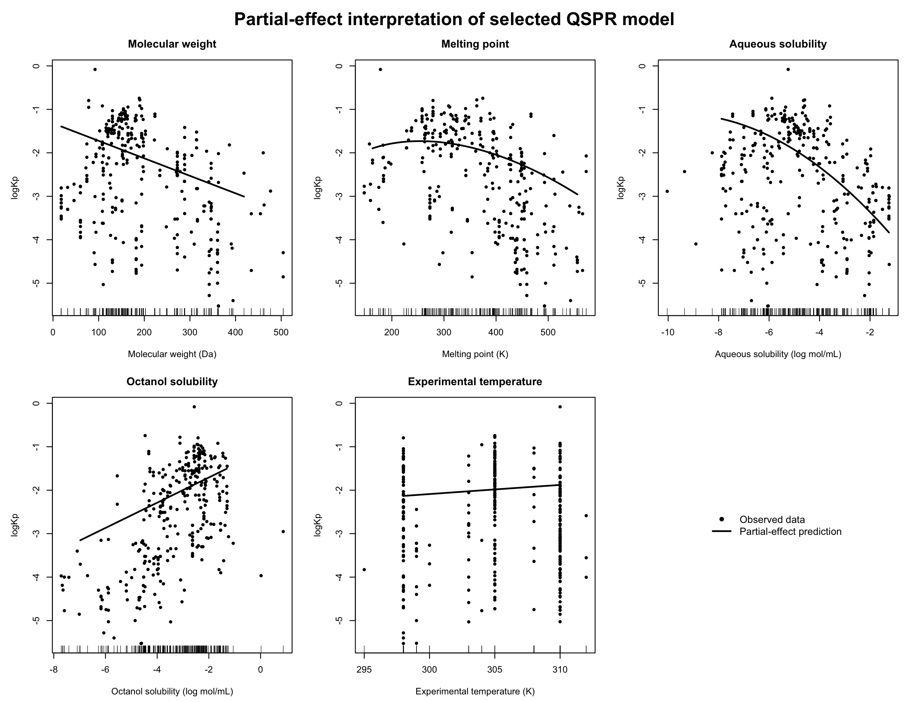

```{r setup, include=FALSE}
knitr::opts_chunk$set(
	echo = FALSE,
	warning = FALSE,
	message = FALSE,
	fig.align = "center",
	fig.width = 7,
	fig.height = 5,
	out.width = "75%"
)

repo_root <- ".."
p <- function(...) file.path(repo_root, ...)

cleaning_flow_path <- p(
	"results",
	"cleaning",
	"cleaning_flow.csv"
)

if (!file.exists(cleaning_flow_path)) {
	stop(
		"Missing cleaning-flow table: ",
		cleaning_flow_path,
		"
Run R/01_clean_data.R before rendering the manuscript.",
		call. = FALSE
	)
}

cleaning_flow <- read.csv(
	cleaning_flow_path,
	stringsAsFactors = FALSE
)

final_row <- cleaning_flow[
	cleaning_flow$step == "Final modeling dataset",
	,
	drop = FALSE
]

if (nrow(final_row) != 1) {
	stop(
		"Expected exactly one 'Final modeling dataset' row in cleaning_flow.csv.",
		call. = FALSE
	)
}

final_observations <- final_row$observations
final_compounds <- final_row$unique_compounds
```

# Abstract

Reported skin permeability values are commonly used for transdermal exposure assessment, topical delivery, and compound screening, but these values are experimentally measured outcomes rather than purely intrinsic molecular properties. Literature-curated skin-permeability datasets therefore contain both chemical signal and experimental-context variation.

This study reframes human skin-permeability prediction as a predictability problem. Repeated observations in a curated human skin-permeability dataset were used to quantify within-compound disagreement, reference-level variability, and empirical repeatability of reported `logKp`. A transparent QSPR model was retained as a benchmark for comparing model prediction error against observed experimental disagreement.

NOTE: Add quantitative results after repeated-measurement scripts are generated: number of repeat-observed compounds, median within-compound pairwise difference, variance-component estimates, ICC/repeatability, and model-error-versus-repeat-disagreement comparison.

The central contribution is an audit-oriented framework for interpreting QSPR error in relation to the variability structure of the measured endpoint. The analysis distinguishes chemical predictability from experimental/contextual variation and provides a basis for deciding when model error is large relative to empirical disagreement already present in the literature-derived data.

# Keywords

Skin permeability; QSPR; repeatability; variance components; experimental variability; validation design

# Introduction

Skin permeability prediction is challenging because permeability is not determined by compound structure alone. Passive transport across skin is strongly constrained by the stratum corneum, a heterogeneous lipid-rich barrier that controls partitioning and diffusion [@potts1992predicting; @chen2013hydrophilic]. Reported permeability values are also shaped by formulation and experimental context, including vehicle composition, exposure conditions, membrane source, and assay design, all of which can influence solubility and partitioning into the skin barrier [@karadzovska2013vehicles; @chedik2024update]. Computational models therefore need to represent molecular and physicochemical determinants while remaining aware that the measured endpoint also contains experimental-context variation.

Experimental skin permeability is commonly measured using in vitro diffusion systems, including Franz diffusion cells, excised human or animal skin, reconstructed skin models, and membrane-based surrogate assays [@oecd2004tg428; @neupane2020alternatives; @jacobi2005comparison]. These assays provide direct empirical estimates of permeability or flux, but they are resource-intensive and difficult to scale across large chemical libraries. Measurements depend not only on the compound itself, but also on membrane source, donor and receptor conditions, vehicle, exposure duration, analytical method, and endpoint definition. As a result, permeability values compiled from the literature reflect both intrinsic compound properties and variation introduced by experimental conditions [@karadzovska2013vehicles; @mitragotri2011mathematical].

Curated skin-permeability datasets provide an attractive basis for computational modeling because they aggregate reported measurements and descriptors across many compounds and studies. The dataset used in the present study was compiled from published in vitro human skin permeation reports and includes permeability coefficients, maximum flux values, physicochemical descriptors, and experimental-condition variables for drugs, xenobiotics, and other solutes applied from aqueous solutions [@cheruvu2022updated]. However, such datasets are not simple collections of independent compound-level observations. They often contain repeated measurements for the same compound, variable exposure times, inconsistent experimental conditions, and descriptors obtained or harmonized from multiple chemical information sources. These properties increase chemical and experimental coverage, but they also create risks for model fitting, interpretation, and validation.

Classical skin-permeability equations established an important physicochemical foundation for prediction. The Potts--Guy relationship showed that skin permeability could be approximated using molecular weight and octanol--water partitioning, providing a simple empirical model that remains widely used as a reference equation [@potts1992predicting]. Related empirical models and later refinements similarly emphasized the importance of molecular size, lipophilicity, hydrogen-bonding capacity, and partitioning behavior in percutaneous absorption [@potts1995predictive; @moss2002qspr; @patel2002qsar]. These models remain useful because they are transparent and easy to interpret. They also reflect core principles of skin transport, including partitioning into lipid-rich stratum-corneum domains, diffusion through the barrier, solubility constraints, and, depending on the assay, vehicle-dependent transport behavior.

Skin-permeability modeling has since developed through several overlapping traditions. Empirical equations such as the Potts--Guy model provided simple relationships between permeability, molecular weight, and octanol--water partitioning [@potts1992predicting]. Subsequent QSAR and QSPR studies expanded this approach using datasets compiled from the skin-permeability literature, including the Flynn dataset and later human-skin permeability compilations, and tested additional descriptors such as melting point, molecular volume, hydrogen-bonding descriptors, polar surface area, solubility, and ionization-related terms [@flynn1990physicochemical; @lian2008evaluation; @tsakovska2017quantitative]. Other studies adopted nonlinear or machine-learning approaches, including artificial neural networks, support vector machines, random forests, hierarchical support vector regression, fragment-contribution models, and RDKit-style cheminformatics descriptor sets [@pecoraro2019computational; @stepanov2020huskindb; @waters2022huskindb; @waters2023fragment; @wu2022twoqsar]. In parallel, mechanistic and semi-mechanistic models have represented skin transport using diffusion, partitioning, compartmental, or microstructure-based descriptions [@mitragotri2011mathematical; @karadzovska2013vehicles]. Together, this literature shows that skin permeability can be modeled from chemical and experimental information, but it also shows that reported performance depends strongly on dataset curation, descriptor selection, endpoint harmonization, and validation design.

Repeated measurements in curated permeability datasets are usually treated as a validation complication, because random row-wise splitting can place measurements of the same compound in both training and test folds. However, repeated measurements also contain useful information. Variation among measurements of the same compound provides an empirical estimate of endpoint disagreement, while variation across references can reveal how much reported permeability depends on literature source and experimental context. These repeated observations therefore provide a way to ask not only which model predicts best, but how predictable reported skin permeability actually is.

A second challenge is that QSPR error is often interpreted without reference to experimental disagreement in the endpoint itself. A model with an RMSE of approximately one log unit may be considered poor if the endpoint is highly repeatable, but comparatively informative if repeated experimental measurements already differ by a similar magnitude. Prediction error should therefore be evaluated against the empirical variability of the measured endpoint, including within-compound disagreement, reference-level heterogeneity, and residual variation not captured by available descriptors.

In this study, a literature-derived human skin-permeability dataset was used to quantify the predictability limits of reported `logKp` values. The primary objective was to estimate how much observed permeability variation is attributable to compound identity, experimental/reference context, and residual measurement variation. A transparent QSPR model was retained as a benchmark for comparing prediction error with empirical repeated-measurement disagreement. The analysis combined repeated-measurement summaries, variance-component modeling, validation-design sensitivity analysis, descriptor-space diagnostics, and QSPR benchmarking to evaluate when model error reflects model weakness and when it approaches the variability already present in the experimental literature.

NOTE: Add one final sentence after numerical results are available, stating the principal empirical conclusion about whether QSPR error is larger than, smaller than, or comparable to repeated-measurement disagreement.

# Methods

The analysis followed a scripted workflow from dataset curation to repeated-measurement variability analysis, QSPR benchmarking, and validation-design sensitivity assessment (Figure \@ref(fig:workflow)). The workflow treated repeated observations as empirical information about endpoint variability rather than only as a validation nuisance.

```{r workflow, echo=FALSE, fig.cap="(\#fig:workflow) Predictability-audit workflow for human skin-permeability modeling. The workflow begins with curation of a literature-derived permeability dataset, followed by construction of a repeat-preserving analysis dataset and a collapsed modeling dataset. Repeated observations are used to quantify empirical disagreement and variance components. QSPR models are then evaluated as benchmarks and interpreted relative to repeated-measurement variability, validation design, and descriptor-space applicability domain.", out.width="100%", fig.align="center", fig.pos="H"}

```

## Data source and preprocessing

### Dataset and endpoint

The analysis used the literature-derived human skin permeability dataset compiled by Cheruvu et al. [@cheruvu2022updated]. In the present analysis, the response variable was `logkpl`, the logarithm of the reported epidermal permeability coefficient, \(K_p\). Mechanistically, \(K_p\) describes the proportionality between steady-state permeation flux and the concentration driving force across the skin barrier, \(J = K_p \Delta C\). For a simplified membrane, \(K_p\) can be represented as \(K_p = KD/h\), linking permeability to membrane/vehicle partitioning (\(K\)), effective diffusion (\(D\)), and membrane thickness (\(h\)). In skin, these terms are effective quantities because transport is governed by the heterogeneous stratum corneum and modified by formulation and assay conditions [@potts1992predicting; @mitragotri2011mathematical; @chen2018molecular]. The logarithmic endpoint was used because \(K_p\) values span several orders of magnitude and because log-scale permeability is standard in empirical and QSPR skin-permeability modeling [@potts1992predicting; @cheruvu2022updated].

The raw dataset was imported from the original Excel file and cleaned using a scripted workflow. Compound names and CAS numbers were standardized. Required identifier, predictor, experimental-condition, and endpoint fields were inspected for missing values. Incomplete entries and those containing any manually confirmed abnormal descriptor value were removed.

Two analysis datasets were then defined. The repeat-preserving dataset retained eligible observations before collapse and was used to quantify within-compound disagreement, reference-level variability, and experimental-context effects. The collapsed modeling dataset averaged repeated entries from the same reference with the same compound, experimental temperature, skin thickness, and descriptor profile, and was used for QSPR model selection and benchmarking. Cleaning summaries, removed-row logs, missingness summaries, and descriptor-inconsistency checks were exported for auditability.

NOTE: Confirm exact row counts for the repeat-preserving dataset after updating `R/01_clean_data.R`. Add file path for the repeat-preserving dataset and define whether abnormal descriptor filtering is applied before repeated-measurement analysis.

### Descriptor set

Candidate QSPR descriptors were taken from the physicochemical-property and experimental-condition variables reported in the compiled dataset by Cheruvu et al. [@cheruvu2022updated]. The variables used in this analysis included compound identifiers, solute physicochemical properties, experimental temperature, skin thickness, the permeability endpoint, and literature reference. Descriptor names and units were retained from the source dataset and are summarized in Table \@ref(tab:descriptor-table). Not all candidate descriptors were retained in the final selected model.

```{r descriptor-table, echo=FALSE}
descriptor_table <- data.frame(
	Variable = c(
		"`MWa`",
		"`logKowb`",
		"`Mptc`",
		"`LogSaqd`",
		"`LogSoce`",
		"`Hdf`",
		"`Hag`",
		"`MVh`",
		"`Texpi`",
		"`Skin.thicknessj`",
		"`logkpl`"
	),
	`Description` = c(
		"Molecular weight",
		"Octanol-water partition coefficient, Log P or Log ko/w",
		"Melting point",
		"Aqueous solubility, Log Saq",
		"Octanol solubility, Log Soc",
		"Hydrogen donor count",
		"Hydrogen acceptor count",
		"Molecular volume",
		"Experimental temperature, Texp",
		"Skin thickness",
		"Skin permeability, Log kp"
	),
	`Unit` = c(
		"Daltons",
		"log unitless",
		"Kelvin",
		"log mol/mL",
		"log mol/mL",
		"count",
		"count",
		"cm³/mol",
		"Kelvin",
		"mm",
		"log cm/h"
	),
	check.names = FALSE
)

knitr::kable(
	descriptor_table,
	caption = "(\\#tab:descriptor-table) Candidate QSPR descriptors, experimental-condition variables, and response endpoint used in the analysis, with names and units retained from the Cheruvu et al. dataset.",
	booktabs = TRUE,
	table.envir = "table",
	position = "H"
)
```

## Repeated-measurement variability analysis

### Construction of repeat-preserving analysis dataset

A repeat-preserving analysis dataset was constructed to retain eligible observations before averaging repeated experimental profiles. Repeated observations were defined as multiple reported `logkpl` values associated with the same standardized compound identifier. Reference identity was retained to distinguish repeated observations reported within the same literature source from repeated observations reported across different sources.

NOTE: Add exact definitions after code implementation: compound identifier column, reference identifier column, handling of duplicate rows, treatment of identical experimental profiles, and minimum repeat count required for each summary.

### Within-compound and between-compound variability

Within-compound variability was quantified among compounds with at least two eligible `logkpl` observations. Summaries included within-compound standard deviation, within-compound range, and pairwise absolute differences between repeated observations of the same compound. Pairwise differences were summarized using the median, interquartile range, and proportions exceeding 0.5 and 1.0 log units. Between-compound variability was summarized using compound-level mean `logkpl` values.

NOTE: Generate manuscript table for repeated-measurement summaries: number of repeated compounds, number of same-compound pairs, median within-compound SD, median within-compound range, median pairwise absolute difference, percentage of pairs >0.5 log unit, and percentage of pairs >1 log unit.

### Reference-level and experimental-context variability

Reference-level variability was assessed by comparing repeated observations reported within the same reference with repeated observations reported across different references, where sufficient replication was available. Available experimental-context variables, including experimental temperature and skin thickness, were evaluated as potential contributors to observed `logkpl` variability.

NOTE: Add exploratory summaries for same-reference versus between-reference pairwise disagreement. Add notes on metadata limitations if experimental-context fields are sparse or weakly variable.

### Variance-component and repeatability analysis

Variance-component models were used to estimate how much observed `logkpl` variability was attributable to compound identity, literature reference, available experimental covariates, and residual variation. Candidate mixed-effects models included random intercepts for compound identity and literature reference, with selected physicochemical and experimental-context variables added as fixed effects when supported by the data structure.

A minimal variance-component sequence was planned as follows:

\[
\mathrm{log}K_{p,ij} = \beta_0 + u_{\mathrm{compound},i} + \epsilon_{ij},
\]

\[
\mathrm{log}K_{p,ij} = \beta_0 + u_{\mathrm{compound},i} + u_{\mathrm{reference},j} + \epsilon_{ij},
\]

\[
\mathrm{log}K_{p,ij} = f(\mathrm{chemistry}_i) + \beta X_{ij} + u_{\mathrm{reference},j} + \epsilon_{ij}.
\]

Intraclass correlation and variance proportions were calculated to summarize repeatability and the relative contributions of compound-level, reference-level, and residual variability.

NOTE: Choose final model specification after inspecting repeat structure. Add package and estimation method, likely `lme4::lmer()` or `nlme::lme()`. Add handling for singular fits and sparse references.

### Model error versus empirical disagreement

QSPR prediction error was compared with empirical same-compound disagreement. The primary comparison used the distribution of absolute LOCO-CV prediction errors and the distribution of pairwise absolute differences among repeated measurements of the same compound. This comparison was used to assess whether model error was substantially larger than, smaller than, or comparable to repeated-measurement disagreement in the literature-derived endpoint.

NOTE: Generate main figure comparing absolute model error, same-compound pairwise disagreement, and between-compound pairwise disagreement. Use this as the central figure for the revised manuscript.


## QSPR benchmark model development

### Descriptor redundancy screening

Before candidate-model evaluation, descriptor redundancy was assessed using pairwise Pearson correlations and variance inflation factors (VIF). Pairwise correlations were used to identify directly redundant descriptor pairs, whereas VIF was used to detect descriptors involved in broader multivariable redundancy. Highly redundant combinations were exported as red-flag predictor sets and excluded from subsequent candidate-model search. Individual descriptors were not removed from the model search but the candidate formulas containing red-flag combinations would be skipped during model search.

Descriptor redundancy was assessed before candidate-model evaluation because several candidate QSPR descriptors were expected to be chemically related. In particular, aqueous solubility is not independent of lipophilicity and melting point: the General Solubility Equation represents aqueous solubility as a function of octanol--water partitioning and melting point, commonly written as \(\log S = 0.5 - 0.01(MP - 25) - \log K_{ow}\), with melting point expressed in degrees Celsius [@jain2001gse; @ran2002gse]. This relationship reflects the contribution of both crystal-lattice/solid-state effects and hydrophobicity to aqueous solubility. Therefore, `Mptc`, `logKowb`, `LogSaqd`, and `LogSoce` were screened for redundancy before model selection.

The redundancy analysis compared the reported aqueous solubility (`LogSaqd`) with a General Solubility Equation estimate calculated from `logKowb` and melting point `Mptc` in Celsius. Pairwise correlations were calculated among `logKowb`, `Mptc`, `LogSaqd`, `LogSoce`, and the estimated GSE solubility. Linear models were then used to quantify how much variation in `LogSaqd` and `LogSoce` could be explained by `logKowb` and `Mptc`, and variance inflation factors (VIF) were calculated for the solubility-related descriptor set. This redundancy screening was used to inform candidate-model construction and interpretation, but final descriptor retention was determined by compound-level cross-validated model selection.

### QSPR benchmark model selection

Candidate QSPR benchmark models were selected using leave-one-compound-out cross-validation (LOCO-CV). In each fold, all observations belonging to one compound were held out as the test set, and the model was fitted using observations from all remaining compounds. This design prevents repeated measurements of the same compound from appearing in both training and test sets, so performance reflects generalization to unseen compounds rather than interpolation among repeated observations.

The candidate-model search was staged to allow increasing model flexibility while controlling unnecessary complexity. First, a set of linear candidate models from the initial predictor-screening step was evaluated under LOCO-CV. Candidate formulas were then expanded sequentially by adding quadratic terms, log-transformed terms, one omitted linear predictor, and one two-way interaction term. Duplicate formulas were removed before evaluation. Models were ranked primarily by LOCO-CV root mean squared error (RMSE), while mean absolute error (MAE), predictive \(R^2\), Pearson correlation, number of base predictors, number of quadratic terms, and total number of model terms were retained as secondary summaries.

To avoid selecting a more complex model for a negligible gain in prediction error, models within 0.01 RMSE units of the best-performing model at each stage were treated as competitive candidates. Among these competitive models, simpler formulas were prioritized by the number of terms. The final selected model was the simplest model within 0.01 RMSE units of the best model in the final candidate set. This selected QSPR model was used as a benchmark for comparing model prediction error with empirical repeated-measurement variability, rather than as the sole endpoint of the study.

### Performance metrics

For each observation \(i = 1, \ldots, n\), let \(y_i\) denote the observed `logkpl` value and \(\hat{y}_i\) denote the corresponding compound-level cross-validation prediction. Prediction error was defined as

\[
e_i = y_i - \hat{y}_i .
\]

RMSE and MAE were used to summarize prediction error magnitude:

\[
\mathrm{RMSE}
=
\sqrt{
\frac{1}{n}
\sum_{i=1}^{n}
\left(y_i - \hat{y}_i\right)^2
},
\]

\[
\mathrm{MAE}
=
\frac{1}{n}
\sum_{i=1}^{n}
\left|y_i - \hat{y}_i\right|.
\]

Predictive \(R^2\) was calculated relative to the mean observed endpoint value:

\[
R^2_{\mathrm{pred}}
=
1 -
\frac{
\sum_{i=1}^{n}
\left(y_i - \hat{y}_i\right)^2
}{
\sum_{i=1}^{n}
\left(y_i - \bar{y}\right)^2
},
\qquad
\bar{y}
=
\frac{1}{n}
\sum_{i=1}^{n}
y_i .
\]

Pearson correlation was reported as a complementary measure of observed--predicted agreement:

\[
r
=
\frac{
\sum_{i=1}^{n}
\left(y_i - \bar{y}\right)
\left(\hat{y}_i - \bar{\hat{y}}\right)
}{
\sqrt{
\sum_{i=1}^{n}
\left(y_i - \bar{y}\right)^2
}
\sqrt{
\sum_{i=1}^{n}
\left(\hat{y}_i - \bar{\hat{y}}\right)^2
}
},
\qquad
\bar{\hat{y}}
=
\frac{1}{n}
\sum_{i=1}^{n}
\hat{y}_i .
\]

RMSE was the primary selection criterion. MAE, predictive \(R^2\), and Pearson correlation were used to characterize model performance after selection.

## Benchmarking and model auditing

### Benchmark models

The selected interpretable QSPR model was compared with a hierarchy of benchmark models under the same leave-one-compound-out cross-validation scheme. Dataset-descriptor benchmarks included a null mean model, a Potts--Guy-style model using molecular weight and lipophilicity, a linear model using the predictors retained in the selected model, the selected interpretable QSPR model itself, and a random forest model using the same selected predictors. These comparisons tested whether performance improved over a mean-only baseline, a classical permeability equation, a purely linear selected-predictor model, and a flexible nonparametric model using the same descriptor set.

Random forest models were used as flexible predictive benchmarks [@breiman2001randomforest]. These models were included to provide a nonparametric comparator for the transparent QSPR benchmark, not as the primary target of interpretation.

Additional structure-derived benchmarks were generated from curated SMILES using RDKit. SMILES strings provide text representations of molecular structures that can be parsed computationally, and RDKit was used to calculate molecular descriptors from these structures. RDKit-derived descriptors provided a structure-based comparator to the descriptors already reported in the Cheruvu et al. dataset. Random forest models were then evaluated using RDKit molecular descriptors alone and using RDKit molecular descriptors combined with experimental-condition variables. This comparison was included to distinguish the contribution of molecular structure-derived information from the contribution of experimental context.

The main benchmark table reported the null mean model, Potts--Guy-style model, linear selected-predictor model, selected interpretable QSPR model, random forest using selected predictors, RDKit molecular-only random forest, and RDKit molecular-plus-experimental random forest. Additional benchmark variants were retained in a supplementary benchmark table.

### Applicability-domain and descriptor-space diagnostics

Descriptor relationships were examined for predictors retained in the selected QSPR model. The selected model formula was read from the model-selection output, and the corresponding predictor names were extracted programmatically. A complete-case descriptor dataset was generated containing compound identifiers, compound names, CAS numbers, observed `logkpl`, and the selected model predictors. This dataset was exported for downstream diagnostic and applicability-domain analyses.

For each selected predictor, the relationship with observed `logkpl` was visualized using scatter plots with LOWESS smoothing. Rug plots were added to show the empirical distribution of each descriptor. Descriptor quantile boundaries were overlaid at the 10th and 90th percentiles and at the 2.5th and 97.5th percentiles to show where observations were concentrated and where the descriptor space became sparse.

For applicability-domain classification, descriptor coverage was defined using empirical percentile ranges of the predictors retained in the selected model. For each selected descriptor, observations within the 10th–90th percentile range were classified as central, observations between the 2.5th–10th or 90th–97.5th percentile ranges were classified as intermediate, and observations outside the 2.5th–97.5th percentile range were classified as outside the broad descriptor domain. Observation-level domain categories were then summarized across selected descriptors to compare prediction error within central, intermediate, and outside-domain regions. This percentile-based classification was used only for applicability-domain interpretation and was not used for model fitting or model selection.

### Ablation analysis

Ablation analysis was performed to evaluate how the selected QSPR model depended on its retained descriptor groups and model structure. The selected model was refitted and re-evaluated under cross-validation after removing specific groups of terms. Ablation models included removal of molecular-weight terms, melting-point terms, aqueous-solubility terms, octanol-solubility terms, experimental-temperature terms, interaction terms, and all nonlinear terms. A linear selected-predictor model was also evaluated by retaining only the base predictors from the selected model. All ablation models were evaluated on a common complete-case dataset so that performance differences reflected model structure rather than changes in sample composition.

For each ablation model, LOCO-CV predictions were generated using the same compound-level splitting procedure as the primary model. Performance was summarized using RMSE, MAE, predictive \(R^2\), Pearson correlation, mean error, median absolute error, and the proportion of observations with absolute error greater than 1 log unit. Differences in RMSE, MAE, and predictive \(R^2\) were calculated relative to the full selected model. This analysis was used to assess the contribution of selected descriptor groups and nonlinear or interaction terms to predictive performance.

### Partial-effect and interaction-effect analysis

Partial-effect analysis was performed to aid interpretation of the selected parametric QSPR model. The selected model was refitted on the full cleaned modeling dataset, and predicted `logkpl` was calculated across a grid of values for each retained predictor while holding all other selected predictors at their median values. For each predictor, the grid was restricted to the 2.5th--97.5th percentile range of the observed data to avoid interpreting extrapolated effects at extreme descriptor values. Observed data points and rug plots were shown alongside the predicted partial-effect curves to indicate the empirical support across the descriptor range.

Because the selected model included an interaction between molecular weight (`MWa`) and aqueous solubility (`LogSaqd`), an additional interaction-effect analysis was generated. Predicted `logkpl` was calculated across the observed molecular-weight range while fixing `LogSaqd` at its 10th percentile, median, and 90th percentile values, with other predictors held at their medians. This analysis was used to visualize how the effect of molecular weight differed across aqueous-solubility levels.

## Validation-design sensitivity analyses

### Row-wise cross-validation sensitivity analysis

A row-wise cross-validation sensitivity analysis was performed to assess how validation results changed when compound identity was ignored during data splitting. Unlike compound-level cross-validation, random row-wise splitting can assign different observations of the same compound to both training and test sets. This setting may therefore produce optimistic estimates of generalization when repeated compound measurements are present.

The selected QSPR formula was re-evaluated using repeated 5-fold row-wise cross-validation. In each repeat, observations were randomly assigned to five folds; the model was fitted on four folds and evaluated on the remaining fold until every observation had been predicted once per repeat. The procedure was repeated 50 times. Predictions were then pooled across folds and repeats.

This analysis was used only to assess sensitivity to validation design and was not used for model selection.

### Leave-one-reference-out sensitivity analysis

As an additional validation-design sensitivity analysis, the final selected QSPR formula was evaluated using leave-one-reference-out cross-validation. In each fold, all observations from one literature reference were withheld as the test set, and the model was fitted using observations from all remaining references. This analysis was designed to assess robustness to literature-source heterogeneity, including differences in experimental protocol, reporting practice, compound selection, and measurement conditions across studies.

This validation setting approximates a practical use case in which a model developed from publicly curated permeability data is applied to permeability measurements from an independent literature source or laboratory. However, because the same compound may appear in multiple references, leave-one-reference-out cross-validation does not necessarily represent strict prediction of unseen compounds. It was therefore interpreted as a reference-level robustness analysis rather than as the primary compound-generalization estimate. Compound overlap between each held-out reference and the corresponding training set was quantified for each fold.

## Supplementary diagnostic analyses

### Coefficient-stability analysis

Coefficient stability was assessed by refitting the selected model across the compound-level cross-validation training folds and summarizing fold-specific coefficient estimates. For each retained term, the mean, standard deviation, and relative standard deviation of the coefficient estimate were calculated across folds. This analysis was used only as an interpretability diagnostic and was not used for model selection.

### Compound-level cross-validation error diagnostics

After model selection, compound-level cross-validation residuals and absolute errors were summarized to characterize prediction behavior. Diagnostics included descriptor-wise residual plots, descriptor-wise absolute-error plots, prediction-error density, and identification of observations with absolute error greater than 1 log unit. These diagnostics were used to characterize model errors and were not used to refit or reselect the final model.

### Heteroscedastic uncertainty analysis

A secondary heteroscedastic uncertainty analysis was performed to examine whether prediction uncertainty varied across descriptor space. The selected QSPR model was used as the mean function, and Gaussian variance models were fitted with log-variance modeled as a function of candidate variance predictors. This analysis characterized uncertainty behavior but did not alter the selected mean model.

# Results

## Dataset structure and repeated measurements

The cleaned collapsed modeling dataset contained `r final_observations` observations representing `r final_compounds` unique compounds (Table \@ref(tab:data-cleaning)). This table currently summarizes the QSPR modeling dataset after repeated profiles were collapsed.

```{r data-cleaning, echo=FALSE}
table1_path <- p(
	"manuscript",
	"tables",
	"table1_data_cleaning_attrition.csv"
)

table1_data_cleaning <- read.csv(
	table1_path,
	stringsAsFactors = FALSE,
	check.names = FALSE
)

knitr::kable(
	table1_data_cleaning,
	caption = "(\\#tab:data-cleaning) Data-cleaning and dataset attrition summary for the human skin permeability modeling dataset.",
	booktabs = TRUE,
	table.envir = "table",
	position = "H"
)
```

NOTE: Replace or supplement Table \@ref(tab:data-cleaning) with a repeat-structure table after repeat-preserving data are generated. Required rows: raw imported dataset, repeat-preserving cleaned dataset, collapsed modeling dataset. Required columns: observations, unique compounds, references, compounds with at least two observations, compounds with at least three observations, median observations per repeated compound.

NOTE: Add a new main figure showing repeated-measurement structure. Suggested options: histogram of observations per compound, histogram of observations per reference, or strip plot of repeated `logKp` values for compounds with the largest number of observations.

## Within-compound repeated-measurement variability

Repeated measurements were used to estimate empirical disagreement in reported `logKp` values for the same compound. This analysis treats repeated observations as information about endpoint repeatability rather than only as a validation nuisance.

NOTE: Add results from repeated-measurement script: number of compounds with repeated observations, number of same-compound observation pairs, median within-compound SD, median within-compound range, median pairwise absolute difference, percentage of same-compound pairs differing by >0.5 log unit, and percentage differing by >1 log unit.

NOTE: Add main table: repeated-measurement variability summary. Suggested caption: "Within-compound disagreement among repeated `logKp` measurements."

NOTE: Add main figure: distribution of same-compound pairwise absolute differences in `logKp`. This figure should become a central figure in the revised manuscript.

## Compound-level, reference-level, and residual variance components

Variance-component analysis was used to estimate how much observed `logKp` variability was attributable to compound identity, literature reference, measured experimental covariates, and residual variation.

NOTE: Add variance-component table after mixed-effects models are implemented. Required columns: model, compound variance, reference variance, residual variance, compound ICC, reference variance proportion, residual variance proportion, number of observations, number of compounds, number of references.

NOTE: Add concise interpretation: chemical signal exists if compound-level variance is substantial; experimental/reference signal exists if reference-level variance remains after compound identity or chemical descriptors are included; residual variability defines unexplained empirical disagreement.

## Experimental-context contributions

Available experimental-context variables were evaluated to determine whether reported `logKp` variability was partly explained by measured assay conditions. Candidate context variables included experimental temperature (`Texpi`) and skin thickness (`Skin.thicknessj`), with literature reference used as a broader proxy for unmeasured protocol differences.

NOTE: Add results for experimental-context variables after model implementation. State whether temperature, skin thickness, reference identity, or other available fields explain meaningful variability. If metadata are sparse or weakly variable, state that limitation directly.

## QSPR benchmark performance relative to empirical disagreement

The selected QSPR benchmark model was retained to evaluate whether model prediction error was large relative to empirical repeated-measurement disagreement. The final selected benchmark model was:

\[
\begin{aligned}
\mathrm{log}K_p ={}&
\beta_0
+ \beta_1 \mathrm{MWa}
+ \beta_2 \log(\mathrm{Mptc})
+ \beta_3 \mathrm{LogSaqd}
+ \beta_4 \mathrm{LogSoce} \\
&+ \beta_5 \log(\mathrm{Texpi})
+ \beta_6 \mathrm{Mptc}^2
+ \beta_7 \mathrm{LogSaqd}^2
+ \beta_8 (\mathrm{MWa} \times \mathrm{LogSaqd}).
\end{aligned}
\]

```{r selected-model-performance-values, echo=FALSE}
final_model_performance <- read.csv(
	p(
		"tables",
		"table_final_model_performance_summary.csv"
	),
	stringsAsFactors = FALSE,
	check.names = FALSE
)

selected_model_performance <- final_model_performance[
	final_model_performance$analysis == "Selected model LOCO-CV",
	,
	drop = FALSE
]

fmt3 <- function(x) {
	sprintf("%.3f", as.numeric(x))
}

selected_model_rmse <- fmt3(selected_model_performance$RMSE)
selected_model_mae <- fmt3(selected_model_performance$MAE)
selected_model_r2 <- fmt3(selected_model_performance$R2_pred)
```

The selected QSPR benchmark achieved RMSE = `r selected_model_rmse`, MAE = `r selected_model_mae`, and predictive \(R^2\) = `r selected_model_r2` under LOCO-CV. These values should be interpreted relative to same-compound empirical disagreement rather than as standalone measures of model quality.

NOTE: Add sentence comparing RMSE and MAE with repeated-measurement variability once calculated. Example structure: "The LOCO-CV RMSE was [larger than / comparable to / smaller than] the median same-compound pairwise disagreement, indicating that model error [exceeds / approaches / falls below] the empirical disagreement present in repeated literature measurements."

```{r fig-observed-vs-loco-predicted, echo=FALSE, fig.cap = "(\\#fig:loco-cv-observed-predicted) Observed versus compound-level cross-validated predicted skin permeability for the final selected model. The dashed line indicates perfect agreement between observed and predicted values. Point color indicates signed prediction error, calculated as observed minus predicted `logKp`.", out.width="90%", fig.align="center", fig.pos="H"}

```

## Model selection and benchmark comparison

Model-selection and benchmark analyses were retained as supporting evidence that the QSPR benchmark was a reasonable comparator for predictability analysis.

```{r table2-model-selection, echo=FALSE, results='asis'}
table2_model_selection <- read.csv(
	p(
		"manuscript",
		"tables",
		"table2_loco_cv_model_selection_summary.csv"
	),
	stringsAsFactors = FALSE,
	check.names = FALSE
)

knitr::kable(
	table2_model_selection,
	caption = "(\\#tab:model-selection) Comparison of the lowest-error candidate and the final selected interpretable model. The final model was selected as a simpler near-optimal alternative rather than the lowest-RMSE candidate alone.",
	booktabs = TRUE,
	align = c("l", "r", "r", "r", "r", "r", "r"),
	format = "latex"
) |>
	kableExtra::kable_styling(
		latex_options = c("hold_position")
	)
```

Benchmark performance is summarized in Table \@ref(tab:benchmark-model-performance). The benchmark hierarchy compares the selected QSPR model with null, classical empirical, linear, random-forest, and RDKit-derived descriptor models.

```{r table4-benchmark-model-performance, echo=FALSE, results='asis'}
table4_benchmark <- read.csv(
	p(
		"manuscript",
		"tables",
		"table4_benchmark_model_performance.csv"
	),
	stringsAsFactors = FALSE,
	check.names = FALSE
)

knitr::kable(
	table4_benchmark,
	caption = "(\\#tab:benchmark-model-performance) Benchmark model performance under compound-level cross-validation.",
	booktabs = TRUE,
	align = c("l", "r", "r", "r", "r", "r"),
	format = "latex"
) |>
	kableExtra::kable_styling(
		latex_options = c(
			"HOLD_position",
			"scale_down"
		),
		position = "center",
		font_size = 8
	) |>
	kableExtra::footnote(
		general = "RDKit RF, molecular descriptors only used structure-derived descriptors calculated from curated SMILES. RDKit RF, molecular + experimental descriptors used the same RDKit descriptors together with experimental-condition variables from the curated dataset. Lower RMSE and MAE indicate lower prediction error; higher predictive R2 indicates better out-of-sample fit.",
		general_title = "Note. ",
		footnote_as_chunk = TRUE,
		threeparttable = TRUE,
		escape = FALSE
	)
```

The benchmark comparison should be interpreted as a model-audit result rather than the primary novelty of the manuscript. The main question is whether prediction error approaches the empirical variability of the measured endpoint.

## Validation design changes the apparent predictability task

```{r define_loro_validation_units, echo=FALSE}
validation_design_sensitivity <- read.csv(
	p(
		"tables",
		"table_validation_design_sensitivity.csv"
	),
	stringsAsFactors = FALSE,
	check.names = FALSE
)

validation_design_sensitivity <- validation_design_sensitivity[
	,
	c(
		"validation_design",
		"held_out_unit",
		"n_validation_units",
		"RMSE",
		"MAE",
		"R2_pred",
		"proportion_compound_seen_in_training"
	),
	drop = FALSE
]

loro_validation_units <- validation_design_sensitivity$n_validation_units[
	validation_design_sensitivity$validation_design == "Leave-one-reference-out CV"
]

if (length(loro_validation_units) != 1) {
	stop(
		"Expected exactly one row for Leave-one-reference-out CV.",
		call. = FALSE
	)
}
```

Validation-design sensitivity analysis compared prediction tasks defined by different held-out units (Table \@ref(tab:validation-design-sensitivity)). Row-wise cross-validation estimates interpolation among observations and may include the same compound in training and test folds. LOCO-CV estimates unseen-compound generalization. Leave-one-reference-out cross-validation evaluates robustness to literature-source heterogeneity.

```{r table-validation-design-sensitivity, echo=FALSE, results='asis'}
validation_design_sensitivity_table <- data.frame(
	"Validation design" = validation_design_sensitivity$validation_design,
	"Held-out unit" = validation_design_sensitivity$held_out_unit,
	"RMSE" = sprintf(
		"%.3f",
		validation_design_sensitivity$RMSE
	),
	"MAE" = sprintf(
		"%.3f",
		validation_design_sensitivity$MAE
	),
	"Predictive R2" = sprintf(
		"%.3f",
		validation_design_sensitivity$R2_pred
	),
	"Compound overlap (%)" = sprintf(
		"%.1f",
		100 * validation_design_sensitivity$proportion_compound_seen_in_training
	),
	check.names = FALSE,
	stringsAsFactors = FALSE
)
knitr::kable(
	validation_design_sensitivity_table,
	caption = "(\\#tab:validation-design-sensitivity) Validation-design sensitivity summary.",
	booktabs = TRUE,
	align = c("l", "l", "r", "r", "r", "r"),
	format = "latex"
) |>
	kableExtra::kable_styling(
		latex_options = c(
			"HOLD_position",
			"scale_down"
		),
		position = "center",
		font_size = 8
	) |>
	kableExtra::footnote(
		general = "Row-wise cross-validation used 50 repeated 5-fold splits.",
		general_title = "Note. ",
		footnote_as_chunk = TRUE,
		threeparttable = TRUE,
		escape = FALSE
	)
```

The repeated row-wise analysis produced slightly lower error than LOCO-CV, whereas leave-one-reference-out cross-validation produced higher error. This pattern indicates that apparent model performance depends on the validation task being evaluated.

NOTE: Revise this paragraph after repeated-measurement analyses are complete. Connect validation-design sensitivity to endpoint variability: row-wise validation may benefit from repeated observations, LOCO-CV removes compound identity from the training set, and leave-one-reference-out validation stresses source-level experimental heterogeneity.

## Descriptor redundancy and chemical interpretation

Descriptor redundancy remained important for interpreting the QSPR benchmark. The full candidate descriptor pool contained substantial collinearity, especially among solubility- and partitioning-related variables (Figure \@ref(fig:descriptor-correlation); Supplementary Table \@ref(tab:vif-summary)).

```{r fig-descriptor-correlation, echo=FALSE, fig.cap="(\\#fig:descriptor-correlation) Candidate descriptor correlation structure. Pairwise Pearson correlations among candidate molecular descriptors and experimental-condition variables. The figure highlights strong redundancy between molecular weight and molecular volume, as well as substantial correlations among solubility- and partitioning-related descriptors.", out.width="90%", fig.align="center", fig.pos="H"}

```

```{r load-vif-values, echo=FALSE}
final_base_vif <- read.csv(
	p(
		"results",
		"descriptor_redundancy",
		"final_base_predictor_vif.csv"
	),
	stringsAsFactors = FALSE,
	check.names = FALSE
)

get_vif <- function(descriptor_name) {
	value <- final_base_vif$VIF[
		final_base_vif$descriptor == descriptor_name
	]

	if (length(value) != 1) {
		stop(
			"Expected exactly one VIF value for descriptor: ",
			descriptor_name,
			call. = FALSE
		)
	}

	sprintf("%.2f", value)
}
```

These results indicate that retained QSPR terms should not be interpreted as isolated causal effects. Solubility-related descriptors should be interpreted as overlapping physicochemical summaries of partitioning, solid-state, and solubility behavior. This limitation is especially important when the QSPR benchmark is compared with empirical variability, because apparent chemical signal may partly reflect correlated descriptor structure.

## Applicability-domain and diagnostic model-audit results

Applicability-domain analysis was retained as a secondary model-audit analysis. The key question is whether descriptor-space position changes the reliability of predictions beyond the empirical disagreement already present in repeated observations.

```{r fig-descriptor-applicability, echo=FALSE, fig.cap = "(\\#fig:descriptor-logkp-relationships) Descriptor-space applicability domain for the selected model. Each panel shows the relationship between a selected model descriptor and observed `logKp`. Shaded regions indicate descriptor-space coverage: central range, 10th–90th percentile; intermediate range, 2.5th–10th and 90th–97.5th percentiles; outside range, beyond the 2.5th–97.5th percentiles. The solid line shows a LOWESS smoother.", out.width="90%", fig.align="center", fig.pos="H"}

```

```{r table-applicability-domain-error-summary, echo=FALSE, results='asis'}
table_applicability_domain_error_summary <- read.csv(
	p(
		"manuscript",
		"tables",
		"table6_applicability_domain_error_summary.csv"
	),
	stringsAsFactors = FALSE,
	check.names = FALSE
)

knitr::kable(
	table_applicability_domain_error_summary,
	caption = "(\\#tab:applicability-domain-error-summary) Prediction-error summary by descriptor-space applicability-domain category.",
	booktabs = TRUE,
	align = c("l", "r", "r", "r", "r"),
	format = "latex"
) |>
	kableExtra::kable_styling(
		latex_options = c(
			"HOLD_position"
		),
		position = "center",
		font_size = 8
	) |>
	kableExtra::footnote(
		general = "The central descriptor domain was defined using the 10th-90th percentile ranges of selected model descriptors. Outside-domain observations had at least one selected descriptor outside the 2.5th-97.5th percentile range.",
		general_title = "Note. ",
		footnote_as_chunk = TRUE,
		threeparttable = TRUE,
		escape = FALSE
	)
```

NOTE: Reinterpret applicability-domain results after repeated-measurement analysis. Suggested framing: outside-domain error reflects both model extrapolation and endpoint variability; descriptor-domain status should be reported alongside expected empirical disagreement.

## Supporting QSPR interpretation analyses

Ablation, partial-effect, and interaction-effect analyses were retained as supporting analyses for interpreting the selected QSPR benchmark. These analyses are no longer the central novelty of the manuscript.

NOTE: Consider moving ablation, partial-effect, and interaction-effect results to Supplementary Results after the repeated-measurement analyses are complete. Keep only a short main-text summary if space is limited.

```{r fig-partial-effect, echo=FALSE, fig.cap = "(\\#fig:partial-effects-selected-model) Partial-effect interpretation of the selected QSPR model. Points show observed data, rugs show the empirical descriptor distributions, and solid lines show model-estimated partial effects calculated while holding other predictors at their median values.", out.width="90%", fig.align="center", fig.pos="H"}

```

```{r fig-interaction-effect-MWa-LogSaqd, echo=FALSE, fig.cap = "(\\#fig:interaction-effect-MWa-LogSaqd) Interaction-effect interpretation for molecular weight and aqueous solubility in the selected QSPR model. Panel A shows the fitted interaction surface across molecular weight and aqueous solubility; background color and contour lines indicate model-predicted `logKp`, while overlaid circle fill indicates reported observed `logKp` at each observed descriptor combination. Panel B shows conditional molecular-weight effect curves at low, median, and high aqueous-solubility levels, corresponding to the 10th, 50th, and 90th percentiles of observed `LogSaqd`. The Panel B background uses the same color scale as a visual reference for predicted `logKp`; other selected predictors were held at their median values.", out.width="95%", fig.align="center", fig.pos="H"}
knitr::include_graphics(
	p(
		"figures",
		"figure_interaction_MWa_LogSaqd_AB.png"
	)
)
```

## Supplementary diagnostic results

Supplementary diagnostics were used to confirm that the selected QSPR benchmark was sufficiently stable and interpretable for comparison against empirical variability.

NOTE: Shorten this section after repeated-measurement results are finalized. Key points to retain: coefficients mostly stable, residuals centered near zero without a single failure descriptor, and heteroscedastic uncertainty structure imperfect but informative.


# Discussion

### Principal finding: predictability is bounded by empirical variability

This study reframes human skin-permeability modeling as a question of endpoint predictability. The central issue is not only whether a QSPR model can reduce prediction error, but whether that error is large relative to the experimental disagreement already present among repeated literature measurements. A literature-derived permeability dataset contains molecular signal, but also reference-level variation, experimental-context effects, and residual measurement disagreement. Model performance therefore requires interpretation against this empirical variability structure.

NOTE: Add one lead sentence with the main quantitative finding after repeated-measurement scripts are complete. Example structure: "The median same-compound disagreement was [x] log units, while LOCO-CV model error was [y] log units, indicating that QSPR error was [larger than / comparable to / smaller than] repeated-measurement disagreement."

### Repeated measurements define an empirical noise floor

Repeated observations provide direct evidence about how much reported `logKp` can vary for the same compound. This variability is not a minor technical inconvenience. It defines an empirical noise floor for predictive modeling. If repeated measurements of the same compound differ substantially, then a model cannot be expected to predict every reported observation with high precision using molecular descriptors alone. In that setting, a prediction error that appears large in absolute terms may still be close to the practical limit imposed by experimental disagreement.

This point changes how QSPR performance should be interpreted. RMSE and MAE are meaningful only when the variability of the endpoint is understood. A model error of 0.6--0.8 log units has a different implication if repeated measurements usually differ by 0.1 log units than if repeated measurements commonly differ by 0.5--1.0 log units. The revised analysis therefore places model error in the context of same-compound disagreement, within-compound variance, and reference-level heterogeneity.

### Chemical signal and experimental-context signal are both present

Skin permeability is governed by physicochemical properties, but reported permeability values are also shaped by experimental context. The variance-component analysis is intended to separate these sources of variation as far as the available data allow. Compound-level variance indicates that chemical identity contributes to the endpoint. Reference-level variance indicates that literature source, protocol, formulation context, or measurement practice also contributes. Residual variance indicates unexplained variation after available compound and context information has been considered.

NOTE: Add variance-component interpretation after model fitting. State whether compound identity dominates, whether reference-level effects are substantial, and whether residual variability remains large. Avoid overclaiming if mixed models are singular or repeated observations are sparse.

The expected conclusion is not that chemical descriptors are irrelevant. Rather, the more defensible conclusion is that chemical predictability exists within a measurement system that also contains experimental and reporting variability. QSPR models should therefore be interpreted as predictors of reported experimental outcomes, not as direct estimators of a context-free molecular permeability constant.

### Implications for QSPR model evaluation

Validation design determines the prediction task. Row-wise validation can estimate interpolation among observations, especially when repeated measurements allow the same compound to appear in both training and test data. Compound-level validation estimates generalization to unseen compounds. Reference-level validation stresses robustness to literature-source heterogeneity. These tasks should not be treated as interchangeable estimates of a single model property.

The validation-design sensitivity analysis therefore supports the broader predictability argument. If model performance changes when the held-out unit changes, then reported accuracy depends on the scientific question being asked. A model intended for repeated measurements of known compounds can be evaluated differently from a model intended for new-compound screening or for transfer across literature sources. Future skin-permeability modeling studies should report validation design explicitly and justify the held-out unit in relation to the intended use case.

### Role of the transparent QSPR benchmark

The selected transparent QSPR model remains useful, but its role changes under the revised framing. The model is no longer the main novelty by itself. Instead, it serves as a benchmark for testing whether physicochemical descriptors can predict reported permeability values beyond the empirical variability of the endpoint. This distinction strengthens the manuscript because the model is used to interrogate predictability rather than to claim novelty from another fitted QSPR equation.

The selected model also remains valuable because its fitted structure can be audited. Descriptor redundancy analysis, ablation, partial effects, applicability-domain assessment, and residual diagnostics help determine whether the benchmark is chemically plausible and whether failures are concentrated in identifiable regions. These audits are important because comparison with empirical disagreement is only meaningful if the benchmark model itself is reasonable.

### Practical interpretation of predictions

The revised analysis supports a practical reporting framework for skin-permeability prediction. A predicted `logKp` value should not be reported alone. Interpretation should include the model prediction, descriptor-domain status, validation design used to estimate error, and the expected empirical disagreement for similar repeated measurements. This approach prevents overinterpretation of individual predictions and makes clear when uncertainty arises from model extrapolation, experimental variability, or both.

Applicability-domain analysis remains useful in this framework. Predictions inside the central descriptor domain are better supported by observed data. Predictions outside the broad descriptor range may still be informative, but they should be flagged as extrapolative. When outside-domain status coincides with high empirical endpoint variability, individual predictions require especially cautious interpretation.

### Strengths and limitations

A major strength of the revised study is the use of repeated observations as empirical information about predictability. The analysis moves beyond reporting model error alone and asks whether model error is large relative to the variability of the measured endpoint. Additional strengths include scripted data cleaning, compound-level validation, validation-design sensitivity analysis, descriptor-redundancy assessment, benchmark comparison, and model diagnostics.

Several limitations require explicit treatment. First, the analysis is based on a literature-derived dataset with incomplete control over experimental protocols and metadata. Second, repeated observations may be unevenly distributed across compounds and references, which can affect variance-component estimates and within-compound summaries. Third, reference identity is an imperfect proxy for protocol, formulation, laboratory, and reporting differences. Fourth, available experimental-context variables may not capture key drivers of permeability variation, such as vehicle composition, ionization state, donor concentration, receptor conditions, skin preparation, or analytical method. Fifth, LOCO-CV reduces compound-level leakage but does not replace validation on an independent external dataset.

NOTE: Add limitation on mixed-effects model stability if sparse repeat structure causes singular fits or wide uncertainty intervals.

### Future directions

Future work should validate the predictability framework across independent skin-permeability datasets, including HuskinDB and SkinPiX, after careful endpoint, unit, and structure harmonization. Cross-database validation with non-overlapping compounds would provide a stronger test of generalization than within-dataset resampling alone. Additional work should also incorporate richer metadata describing formulation, ionization state, donor and receptor conditions, skin source, and assay protocol. Such metadata may be necessary to reduce residual variability and clarify the boundary between chemical predictability and experimental-context dependence.

### Overall interpretation

The main contribution of the revised manuscript is not another QSPR model. The main contribution is a framework for interpreting QSPR prediction error relative to the empirical variability of literature-derived skin-permeability measurements. Transparent QSPR models remain useful, but their predictions should be interpreted together with repeated-measurement disagreement, variance components, validation design, descriptor-domain support, and uncertainty diagnostics.


# Conclusions

This study reframes literature-derived human skin-permeability prediction as a predictability problem. Reported `logKp` values reflect both compound properties and experimental-context variation, so QSPR prediction error should be interpreted relative to repeated-measurement disagreement and variance components of the endpoint. Transparent QSPR models remain useful, but their strongest role is as part of an audited framework that reports predictive performance together with empirical repeatability, validation design, descriptor-domain support, and uncertainty diagnostics.

NOTE: Replace this conclusion with a quantitative version after repeated-measurement analyses are complete. Required elements: same-compound disagreement, variance-component result, QSPR error comparison, and practical recommendation for reporting skin-permeability predictions.

## Data and code availability

Analysis scripts, generated non-sensitive result summaries, manuscript-ready tables, and figures are available in the public GitHub repository: NOTE: add repository URL. The public repository includes the selected-model file, benchmark summaries, applicability-domain summaries, partial-effect outputs, ablation summaries, and final manuscript tables. The source skin-permeability dataset is available from Cheruvu et al. [@cheruvu2022updated].

## Funding

This research project is supported by the Second Century Fund (C2F), Chulalongkorn University

## Competing interests

The author declares no competing interests.

## Acknowledgements

# Supplementary information

\setcounter{table}{0}
\renewcommand{\thetable}{S\arabic{table}}
\setcounter{figure}{0}
\renewcommand{\thefigure}{S\arabic{figure}}

```{r tableS1-vif-summary, echo=FALSE, results='asis'}
tableS1_vif <- read.csv(
	p(
		"manuscript",
		"tables",
		"tableS1_vif_summary.csv"
	),
	stringsAsFactors = FALSE,
	check.names = FALSE
)

knitr::kable(
	tableS1_vif,
	caption = "(\\#tab:vif-summary) Descriptor redundancy summary. Variance inflation factors for the full candidate descriptor set and for the base predictors retained in the final selected model.",
	booktabs = TRUE,
	align = c("l", "r", "r"),
	format = "latex"
) |>
	kableExtra::kable_styling(
		latex_options = c(
			"HOLD_position",
			"scale_down"
		),
		position = "center",
		font_size = 8
	)
```

```{r tableS4-final-model-coefficients, echo=FALSE, results='asis'}
tableS4_final_model_coefficients <- read.csv(
	p(
		"manuscript",
		"tables",
		"tableS4_final_model_coefficients.csv"
	),
	stringsAsFactors = FALSE,
	check.names = FALSE
)

knitr::kable(
	tableS4_final_model_coefficients,
	caption = "(\\#tab:final-model-coefficients) Final fitted coefficients of the selected interpretable QSPR model.",
	booktabs = TRUE,
	align = c("l", "r", "r", "r", "r"),
	format = "latex"
) |>
	kableExtra::kable_styling(
		latex_options = c(
			"HOLD_position",
			"scale_down"
		),
		position = "center",
		font_size = 8
	) |>
	kableExtra::footnote(
		general = "The reported coefficients were obtained by fitting the selected model formula once to the complete final modeling dataset.",
		general_title = "Note. ",
		footnote_as_chunk = TRUE,
		threeparttable = TRUE,
		escape = FALSE
	)
```

```{r fig-benchmark-comparison, echo=FALSE, fig.cap="(\\#fig:benchmark-comparison) Benchmark observed-versus-predicted comparison. Each panel shows compound-level cross-validated observed and predicted `logKp` values for one benchmark model.", out.width="90%", fig.align="center", fig.pos="H"}
knitr::include_graphics(
	p(
		"figures",
		"figure_benchmark_observed_vs_predicted.png"
	)
)
```

```{r tableS2-ablation-analysis-summary, echo=FALSE, results='asis'}
tableS2_ablation <- read.csv(
	p(
		"manuscript",
		"tables",
		"tableS2_ablation_analysis_summary.csv"
	),
	stringsAsFactors = FALSE,
	check.names = FALSE
)

knitr::kable(
	tableS2_ablation,
	caption = "(\\#tab:ablation-analysis-summary) Ablation analysis summary. Each row reports cross-validated performance after removing one component or group of components from the final selected model.",
	booktabs = TRUE,
	align = c("l", "r", "r", "r", "r", "r", "r"),
	format = "latex"
) |>
	kableExtra::kable_styling(
		latex_options = c(
			"HOLD_position",
			"scale_down"
		),
		position = "center",
		font_size = 8
	)
```

```{r tableS3-coefficient-stability-summary, echo=FALSE, results='asis'}
tableS3_coefficient_stability <- read.csv(
	p(
		"manuscript",
		"tables",
		"tableS3_coefficient_stability_summary.csv"
	),
	stringsAsFactors = FALSE,
	check.names = FALSE
)

knitr::kable(
	tableS3_coefficient_stability,
	caption = "(\\#tab:coefficient-stability-summary) Coefficient-stability summary across compound-level cross-validation folds.",
	booktabs = TRUE,
	align = c("l", "r", "r", "r", "r", "r"),
	format = "latex"
) |>
	kableExtra::kable_styling(
		latex_options = c(
			"HOLD_position",
			"scale_down"
		),
		position = "center",
		font_size = 8
	) |>
	kableExtra::footnote(
		general = "Coefficient stability was assessed by refitting the selected model across compound-level training folds. RSD indicates relative standard deviation across fold-specific coefficient estimates.",
		general_title = "Note. ",
		footnote_as_chunk = TRUE,
		threeparttable = TRUE,
		escape = FALSE
	)
```

```{r fig-loco-cv-residual-diagnostics, echo=FALSE, fig.cap="(\\#fig:loco-cv-residual-diagnostics) Descriptor-wise residual error diagnostics for the selected model. Residuals are calculated as observed minus predicted `logKp`.", out.width="95%", fig.align="center", fig.pos="H"}
knitr::include_graphics(
		p(
			"figures",
			"figureS_loco_cv_residual_by_descriptor.png"
		)
)
```

```{r fig-loco-cv-absolute-error-diagnostics, echo=FALSE, fig.cap="(\\#fig:loco-cv-absolute-error-diagnostics) Descriptor-wise absolute error diagnostics for the selected model.", out.width="95%", fig.align="center", fig.pos="H"}
knitr::include_graphics(
		p(
			"figures",
			"figureS_loco_cv_absolute_error_by_descriptor.png"
		)
)
```

```{r fig-error-density, echo=FALSE, fig.cap="(\\#fig:error-density) Distribution of compound-level cross-validated prediction errors for the selected model. Prediction error is calculated as observed minus predicted `logKp`.", out.width="95%", fig.align="center", fig.pos="H"}
knitr::include_graphics(
	p(
		"figures",
		"figureS_loco_cv_error_density.png"
	)
)
```

```{r fig-heteroscedastic-uncertainty, echo=FALSE, fig.cap="(\\#fig:heteroscedastic-uncertainty) Heteroscedastic uncertainty diagnostics for the selected model. The diagnostics evaluate whether prediction uncertainty varies across descriptor space and whether predicted uncertainty corresponds to observed error magnitude.", out.width="85%", fig.align="center", fig.pos="H"}
knitr::include_graphics(
	p(
		"figures",
		"figureS_heteroscedastic_uncertainty_diagnostics.png"
	)
)
```

# References